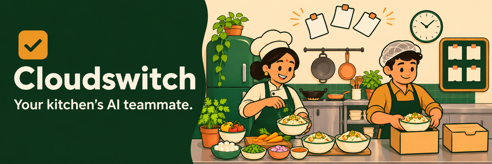
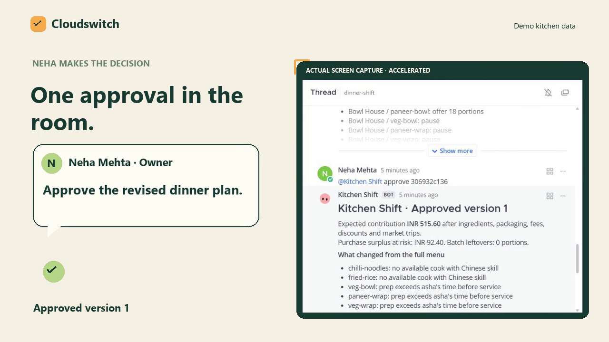
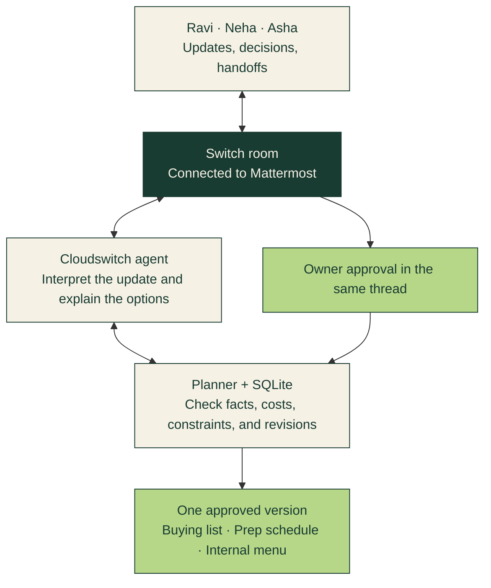

<p align="center">
  
</p>

<p align="center">
  <strong>Turn a message from the kitchen into a revised buying list, prep schedule, and menu plan.</strong>
</p>

<p align="center">
  <a href="#watch-the-workflow">Watch the demo</a> ·
  <a href="#the-innovation">The innovation</a> ·
  <a href="#run-it-locally">Run it locally</a> ·
  <a href="#connect-your-switch-room">Connect Switch</a>
</p>

## The problem

A cloud kitchen can have the food, the menu, and the cooks, while still losing
money through the decisions between them.

Order history lives in delivery-app exports. Ingredient prices sit in another
sheet. Cook availability arrives in a message. The buyer discovers a stockout
at the market. Each update changes what the kitchen can sell, buy, and prepare.
Someone has to connect those facts before the next batch starts cooking.

**A group message can tell everyone that the chillies are unavailable. The
team still needs a revised plan.** Which dishes depend on them? Can another
market supply them in time? Does the extra trip make financial sense? Who can
cook the replacement menu?

Cloudswitch brings that work into the team’s Switch room.

## What the team gets

| Neha Mehta · owner | Ravi Sharma · buyer | Asha Rao · chef |
| --- | --- | --- |
| A feasible menu, expected contribution, and the tradeoffs behind each proposed change. | One shopping list grouped by market, with shared ingredients counted once, costs, and purchase deadlines. | A prep list matched to available cooks, with quantities and start and finish times. |

The team reports what changed. Cloudswitch interprets the update, checks the
kitchen’s data, and proposes a new plan. The owner approves it in the same
thread. Buying, prep, and internal menu availability become **one approved
version**.

## Watch the workflow

<p align="center">
  <a href="https://github.com/OptimistOtaku/Cloudswitch/raw/refs/heads/codex/kitchen-shift/demo/kitchen-shift-animated.mp4">
    
  </a>
</p>

<p align="center">
  <a href="demo/kitchen-shift-animated.mp4"><strong>Watch the 78-second demo</strong></a> ·
  <a href="demo/kitchen-shift-animated.srt">Captions</a> ·
  <a href="demo/verified-run.json">Recorded run evidence</a>
</p>

The video combines an illustrated kitchen with accelerated recordings of the
actual Mattermost conversation and operating-plan interface. The demo uses
sample merchant exports, prices, and kitchen records.

### One dinner shift, three different plans

**Before the buyer leaves.** Friday dinner history suggests demand for Chinese
dishes, but the cook qualified for that station is on leave. Cloudswitch
identifies the conflict and plans dishes Asha can prepare.

**At the market.** Ravi posts in the room.

> **Ravi Sharma · buyer**
>
> Main market is out of fresh green chillies. I can reach East Market at 4:30 pm.

Cloudswitch checks the affected recipes, market hours, travel time, and
supplier availability. It asks Ravi to confirm stock at East Market and
proposes a feasible menu while that fact is unresolved.

**A confirmed order arrives.** Ravi confirms the chillies and reports 18
confirmed paneer bowl orders. Fulfilling those orders changes the decision.
Neha reviews the costs and approves the proposal in the same thread.

| State of the shift | Expected contribution | Decision |
| --- | ---: | --- |
| Initial feasible menu | ₹2,375.40 | Plan four dishes covered by the available cook. |
| Main Market stockout | ₹395.00 | Offer a smaller feasible menu and confirm alternative stock. |
| Stock confirmed + 18 confirmed bowls | ₹515.60 | Make the extra trip and fulfil the confirmed orders. |

**Ravi gets 2 kg of paneer and 250 g of chillies. Asha gets 18 bowls to prep
from 17:00 to 18:00. The menu operator gets the dishes to offer or pause.**

These are projected figures from the editable sample scenario. Its emergency
trip costs ₹1,800. Contribution accounts for ingredients, discounts, platform
fees, packaging, and market trips. Rent, salaries, utilities, tax, refunds,
and cancellation penalties sit outside this calculation.

## The innovation

### A new fact changes the whole shift plan

Cloudswitch connects an unstructured team message to structured kitchen work.
A stockout can change ingredient purchases, feasible dishes, cook assignments,
prep timing, and expected contribution in one proposal. The team can inspect
the costs and constraints behind the recommendation.

### The model understands the update. Code checks the numbers.

The AI interprets messages such as “I can reach the other market by 4:30” and
asks for missing facts. A deterministic planner calculates quantities and
costs, combines shared ingredients, checks cook skills and time, and compares
feasible menu options. Confirmed orders receive priority over forecast demand.

### Approval creates a shared commitment

The owner chooses the proposal in the room. One SQLite transaction saves its
buying list, prep tasks, menu, and stock reservations together. Approval checks
the owner’s exact sender identity, room, thread, and proposal revision.
Repeated messages reuse their recorded result. An older proposal loses approval
eligibility when new facts change the plan.

## Why Switch is central



The agent receives real Switch events, maintains its connection heartbeat,
and posts threaded replies through Switch operations. The room and thread
identify the proposal the owner can approve. That same conversation carries
the buyer’s new facts and the chef’s handoff.

## Run it locally

**Python 3.11+** runs the planner, storage, tests, and local web interface using
the standard library. Natural-language messages use a signed-in `codex` CLI
on `PATH`, or a configured OpenAI-compatible Chat Completions endpoint.

```sh
git clone https://github.com/OptimistOtaku/Cloudswitch.git
cd Cloudswitch

python -m kitchen.cli --data my-shift init
python -m kitchen.cli --data my-shift plan
python -m kitchen.cli --data my-shift web
```

Open [the local demo](http://127.0.0.1:8787). Build a plan, report a market
update, and approve the revision. The local page provides demo role selection.
The live Switch worker verifies identities from the actual chat events.

For a reproducible replay with fixed actions and expected outputs, run:

```sh
python demo/replay.py
```

It reproduces the three contribution totals above and saves an approved
version with its buying, prep, and menu exports.

## Connect your Switch room

1. Start Switch Console, its server, and Mattermost. Create a kitchen room and
   an external agent named `kitchen-shift`. Add the agent and team to the room,
   and configure the agent to accept their messages.
2. Set the shell environment using the variables documented in
   [`.env.example`](.env.example). Copy the agent’s bridge URL, ID, API key,
   and the room’s ID from your Switch setup.
3. Send an onboarding message from each person. Use the opaque `sender` IDs
   in Switch’s authenticated room history for `KITCHEN_OWNER_ID` and
   `KITCHEN_TEAM_IDS`. The owner’s ID must match the person approving plans.
4. Initialize a separate directory for the live room, then start the worker.

```sh
python -m kitchen.cli --data live-shift init
python -m kitchen.cli --data live-shift switch
```

Keep the conversation in one thread. The owner can approve with
`approve <proposal-id>` or select an offered alternative with
`approve <proposal-id> option 1`.

<details>
<summary><strong>Connection variables and model configuration</strong></summary>

| Variable | Purpose |
| --- | --- |
| `SWITCH_URL` | Agent bridge base URL. |
| `SWITCH_AGENT_ID` | Registered agent ID. |
| `SWITCH_API_KEY` | Agent credential. |
| `SWITCH_ROOM_ID` | Kitchen room ID. |
| `KITCHEN_OWNER_ID` | Exact opaque sender ID permitted to approve. |
| `KITCHEN_TEAM_IDS` | Comma-separated buyer, cook, and other permitted sender IDs. |
| `KITCHEN_MODEL_BACKEND` | `codex` by default, or `openai`. |

For the compatible API backend, set `OPENAI_MODEL`, `OPENAI_API_KEY`, and
optionally `OPENAI_BASE_URL`. Set these variables in the shell that starts
the worker. `.env.example` is a configuration reference.

The authenticated history endpoint used by the demo is
`GET /agents/{agent_id}/rooms/{room_id}/history`. Human messages expose their
sender IDs in `events[].sender`.

The worker uses SSE with a generation-fenced heartbeat, a durable inbox,
an outbox, and a resume cursor. An ambiguous network failure can result in a
repeated reply. Planning actions are idempotent by message ID. A Switch buffer
gap is reported in the log and requires resending unacknowledged updates.

[Switch quickstart and documentation](https://docs.switchagents.ai) ·
[Agent protocol](https://github.com/sandbox-quantum/switch/blob/main/docs/official/internals/agent-protocol.md)

</details>

## Data, exports, and closing the shift

| Input | Used for |
| --- | --- |
| Delivery-order CSV | Comparable weekday and service demand, with supporting dates. |
| Recipes and batch sizes | Ingredient requirements and prepared portions. |
| Stock, recorded cost, and use-by dates | Available inventory and allocations. |
| Market quotes, hours, and travel time | Reachable suppliers, purchase costs, and deadlines. |
| Cook skills, roster, and prep time | Feasible assignments before service. |
| Total confirmed orders | Commitments the plan prioritizes fulfilling. |

Edit `kitchen.json` before the first run. After initialization, SQLite holds
the active facts and approved versions. Use chat for supported updates and
`snapshot` to inspect the current state.

Commands `plan`, `action`, and `event`, plus the local page, export
`artifacts/brief.md`, `plan.json`, `buying.csv`, `prep.csv`, and `menu.csv`.
The approved SQLite snapshot is the authoritative version.

<details>
<summary><strong>Calculation details and closing counts</strong></summary>

The importer reads order ID, platform, dish, timestamp, zone, quantity,
revenue, discount, fees, and service. It rejects duplicate order lines and
averages prior matching weekdays and services, counting zero-sale dishes
on represented dates. A fully absent date needs an operator’s interpretation
as missing data or a zero-sales day. Upcoming prices, fees, and discounts
come from the configured dish table.

Dish target sales are the greater of forecast and total confirmed orders.
Prep rounds up to recipe batch size. Shared ingredients aggregate before
buying. Existing stock is charged at recorded cost, purchases at full pack
cost, and trips once per market. Confirmed-order shortfall ranks ahead of
expected contribution. Infeasible orders appear as an exception for the owner.

At closing, record `sold`, `carried`, and `discarded` portions for every
prepared dish. The three counts must balance to prepared portions. Closing
is stored once per approved version.

```text
close {"paneer-bowl":{"sold":17,"carried":0,"discarded":1}}
```

That example applies to the approved catering plan with 18 prepared paneer
bowls. Closing records preserve actual counts separately from projections.
Actual margin needs settlement and purchase receipts. The kitchen supplies
fresh raw-stock counts for the next shift and checks carried food against
its food-safety procedures.

</details>

## Verified behavior

```sh
python -m unittest discover -s tests -v
python demo/replay.py
```

Seven tests cover cook absence, shared stock, known financial totals,
unknown supplier stock, market closure, confirmed-order replanning, expired
stock, alternative selection, concurrent and repeated approvals, identity and
thread checks, stale proposals, rollback, and closing conservation. The
recorded run also exercised actual Mattermost messages, Switch delivery,
model interpretation, and threaded approval.

## Prototype scope

This entry uses sample Swiggy/Zomato-style CSVs. An operator applies the
internal menu’s availability changes to delivery apps. Upcoming planning
prices, fees, and discounts come from editable kitchen records.

The planner compares menu subsets at fixed dish targets, with deterministic
cook assignment and supplier selection. It supports prep before service and
same-day market hours. Forecasts use comparable weekdays and service periods.
Waste reduction and profitability need measurement in a real kitchen using
closing counts and actual financial records.

---

Built for **Best Business Workflow** at Flip the Switch.

Made with [Switch](https://www.switchagents.ai). The Switch mark in the demo
comes from its [official repository](https://github.com/sandbox-quantum/switch/blob/main/gateway/public/switch_logo_light.svg).
